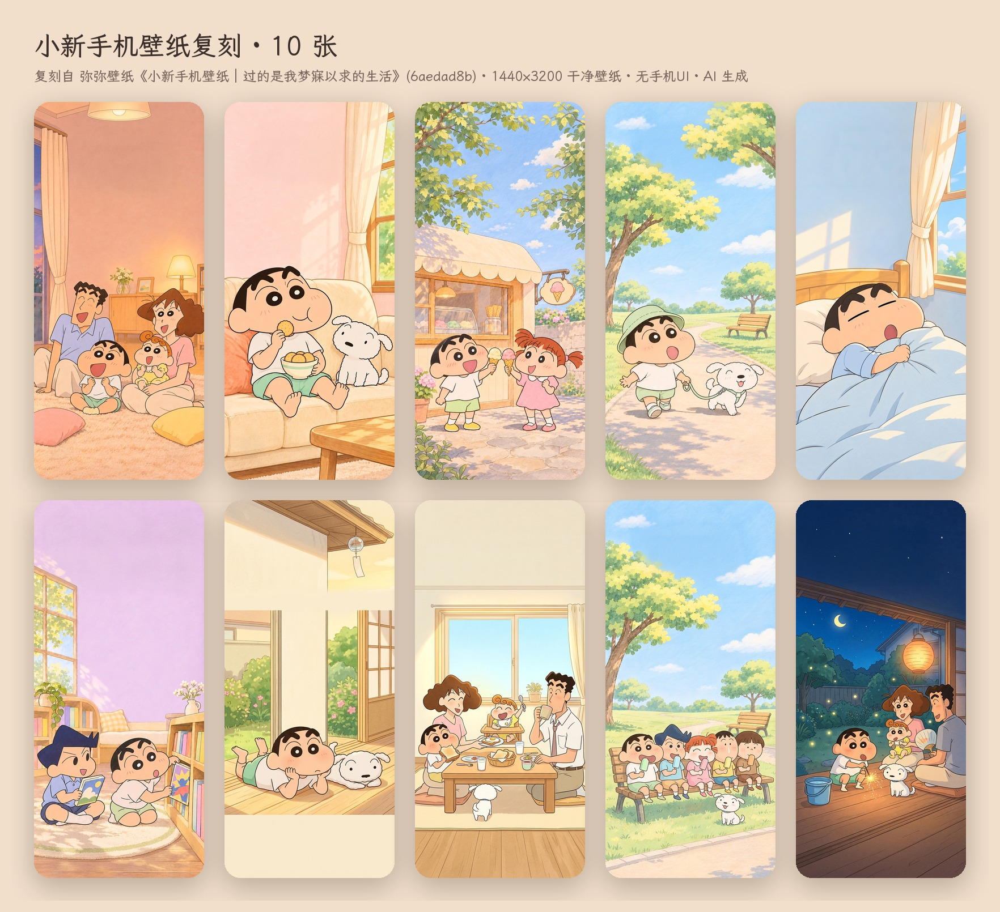

# xhs-wallpaper-replica

把一条小红书壁纸笔记变成一套可发布的复刻壁纸：下载原图 → 生图模型重画无字底图 → 脚本加 iOS 锁屏/主屏覆盖层 → 总图 + 双机封面 → 文案 → Google Drive 按轮归档。技能本体在 [SKILL.md](SKILL.md)。

## 这次跑的例子：弥弥壁纸《小新手机壁纸｜过的是我梦寐以求的生活》

| | 内容 | 位置 |
|---|---|---|
| 第 1 轮 | 原帖 7 张 PNG 原图（1440×3200，第 7 张为 1600×1600 双机海报）+ 笔记文本 | `examples/shinchan-6aedad8b/01-原图/` |
| 第 2 轮 | 复刻 10 张：6 张按原帖逐张重画 + 4 张按正文新补场景（缘侧发呆 / 全家早餐 / 长椅冰棍 / 夏夜线香花火）；全部是 1440×3200 干净壁纸，不带任何手机 UI | `examples/shinchan-6aedad8b/02-复刻/` |
| 总图 | 2×5 拼版 | `02-复刻/总图.jpg` |
| 封面 | 双机预览（两张竖图并排，仿原帖第 7 图的构图，不带手机 UI） | `02-复刻/封面-双机预览.jpg` |
| 第 4 轮 | **新画 10 张**（不是复刻）：雨天窗边 / 放学路上 / 厨房做蛋糕 / 阳台晾被子 / 海边沙堡 / 夏夜西瓜电视 / 雪天堆雪人 / 幼稚园午睡 / 河堤骑车 / 秋日银杏；同一画风、全新场景、1440×3200 干净壁纸 | `examples/shinchan-6aedad8b/03-新画10张/` |
| 第 5 轮 | **再新画 10 张**：樱花野餐 / 鲤鱼旗 / 向日葵花田 / 夏日祭捞金鱼 / 露营星空 / 雨后踩水洼 / 被炉吃橘子 / 装饰圣诞树 / 被窝手电看绘本 / 趴着画蜡笔画 | `examples/shinchan-6aedad8b/04-新画10张-第5轮/` |
| 第 6 轮 | **换一个 IP、换一种玩法**：一二布布《疑似梵高的真迹🤫》（自家 IP，1 张《星月夜》厚涂）→ 先下原片，再让两只熊走进 10 幅名画：梵高·向日葵 / 夜间露天咖啡座 / 麦田与柏树 / 杏花 · 莫奈·睡莲与日本桥 · 葛饰北斋·神奈川冲浪里 · 克里姆特·吻 · 蒙克·呐喊 · 维米尔·戴珍珠耳环的少女 · 达芬奇·蒙娜丽莎；画幅跟原帖一致 1532×2560 | `examples/vangogh-bubu-6aeeecba/`（`01-原片/` 原图+笔记，`02-复刻/` 底图+成图+总图） |
| 第 7 轮 | **一二布布鲜花壁纸**：一二布布壁纸分享（Neverland）《永远开满了鲜花》5 张原图 → 01–05 逐张复刻（百合花田 / 紫藤架 / 红花树 / 雪夜红梅 / 牡丹园）+ 06–10 同风格新花季（油菜花田 / 绣球雨巷 / 荷塘栈道 / 薰衣草黄昏 / 桂花院落）；画幅跟原帖一致 1536×2752，原片与结果分开归档 | `examples/flowers-bubu-6ae3391a/`（`01-原片/` 5 张原图+笔记，`02-复刻/` 底图+成图+总图） |
| 第 8 轮 | **小猫和樱花 · 治愈系壁纸**：屏上集《治愈系壁纸｜小猫和樱花🌸》4 张原图（850×1850 ≈ 9:20）→ 01–04 逐张复刻（樱花晴日 / 海边日落 / 雨后彩虹 / 黄昏许愿）+ 05–10 同一组猫、同一面海墙的新季节（樱吹雪 / 夏日向日葵 / 秋日红叶 / 雪日山茶 / 星夜萤火 / 晨雾热气球）；标准 1440×3200 干净壁纸 + `手机UI预览/`，原片与结果分开归档 | `examples/cat-sakura-6ae8870f/`（`01-原片/` 4 张原图+笔记，`02-复刻/` 底图+壁纸+总图+iOS 预览总图） |
| 第 9 轮 | **猫和老鼠 · 今晚先停战**：小李壁纸分享站《猫和老鼠手机壁纸｜今晚先停战🛋️》18 张原图（1290×2796 ≈ 9:20）→ 原帖多于 10 张，挑最有变化的 10 张逐张复刻（沙发盖被 / 窗边月牙 / 餐桌热牛奶 / 递奶酪 / 火柴盒小床 / 红围巾 / 睡前绘本 / 拖鞋里打盹 / 雨夜窗边 / 床头灯晚安，对应原图 01/03/04/05/07/09/10/11/15/18）；经典 40–50 年代赛璐璐画风、上半屏留给时钟的素墙；标准 1440×3200 干净壁纸 + `手机UI预览/`，原片与结果分开归档 | `examples/tomjerry-6aed5b12/`（`01-原片/` 18 张原图+笔记，`02-复刻/` 底图+壁纸+总图+iOS 预览总图） |
| 第 10 轮 | **日落下的灯塔与海浪 · 厚涂油画**：一只小猫喵喵喵《✨治愈系壁纸 | 日落下的灯塔与海浪🌊》9 张原图（971×1619 = 3:5，印象派厚涂油画）→ 01–09 逐张复刻（灯塔日落 / 面包店门口 / 礁石潮池 / 花架茶座 / 桌上蜜桃 / 山城海港 / 薰衣草石阶 / 系泊小船 / 沙滩藤椅）+ 10 同风格新场景「窗台小猫」（正文「坐一会儿吧」+ 作者名「一只小猫」+ 标题的灯塔）；画幅跟原帖 3:5 → 1536×2560（`painting_set.py`），`手机UI预览/` 用 9:20 居中裁切看装机效果，原片与结果分开归档 | `examples/lighthouse-6aede8e7/`（`01-原片/` 9 张原图+笔记，`02-复刻/` 底图+成图+总图+封面+iOS 预览总图） |
| 第 11 轮 | **线条小狗 · 赏花野餐春天壁纸**：小白和小鸡毛《线条小狗 ｜赏花野餐春天壁纸🍓🍃🌸》14 张原图（尺寸不一 ≈ 9:18.5，扁平粉彩线条小狗）→ 原帖多于 10 张，挑差异最大的 10 张逐张复刻（田野云朵 / 荷塘木桥 / 树下吉他 / 骑滑板车 / 野餐垫 / 气球飞天 / 草地冰淇淋 / 玫瑰爱心 / 兔耳气球 / 樱花秋千，对应原图 01/02/03/04/05/06/08/10/11/13；剔除带 FLYING 字样的 07、主角换了的 09、与 13 同款的 12、偏淡最低清的 14）；白狗 = 松散断续黑线条、黄狗 = 红项圈，提示词写固定描述串不写 IP 名；生图偶尔吐偏宽 848×1264，spec 里每页 `ax` 锚点裁切保住主体；标准 1440×3200 干净壁纸 + `手机UI预览/`，原片与结果分开归档 | `examples/linedog-69bec419/`（`01-原片/` 14 张原图+笔记，`02-复刻/` 底图+壁纸+总图+封面+iOS 预览总图） |
| 第 12 轮 | **和你一起奔夕阳 · 噜噜噜妹情侣壁纸**：等噜噜《和你一起奔夕阳 噜噜噜妹壁纸》5 张原图（1080×1920 = 9:16，写实毛绒玩偶渲染，黄昏逆光）→ 01–05 逐张复刻（草坡小径 / 草坡躺平 / 溪石牵手 / 盘山公路 / 码头看日落）+ 06–10 同风格新场景（山顶云海 / 沙滩奔跑 / 稻田背背 / 芦苇蒲公英 / 山坡风筝，风格锚轮换原图 05/01/04/03/02）；噜噜 = 头顶小橘子 + 西瓜花短裤、噜妹 = 白荷叶边帽 + 草莓裙写成固定描述串；画幅跟原帖 9:16 → 1440×2560（`painting_set.py`），`手机UI预览/` 用 9:20 居中裁切看装机效果，原片与结果分开归档 | `examples/lulu-sunset-6ad212fc/`（`01-原片/` 5 张原图+笔记，`02-复刻/` 底图+成图+总图+封面+iOS 预览总图） |
| 第 13 轮 | **iPhone 景深裸眼 3D 壁纸**：沐子兮《iPhone景深裸眼3D壁纸》9 张原图（尺寸不一 1080×2343 … 2890×6400 ≈ 9:19.5–1:2，转载图源的写实/绘画混合风，画面上部都有一层前景：拱门 / 苹果 / 树冠 / 荷叶）→ 01–09 逐张复刻（云海拱门 / 阳台白猫 / 苹果入水 / 湖畔石拱 / 水面苹果 / 星夜荷叶 / 星星大树 / 云山小屋 / 海边小路）+ 10 同风格新场景「樱花湖岸」（风格锚 原图04）；交付 1440×3200 标准壁纸（`phone_mockup.py`，生图输出 688×1536 零裁切），09 路牌文字改空白木牌、08/09 水印不复刻；**新增景深预览**：`scripts/depth_mask.py`（ISNet 抠前景）+ `phone_mockup.py --mask-dir` 把主体贴回时钟前面，模拟 iOS 16+ 锁屏「景深效果」（03/04/05/08 开，封面左 04 右 03）；**09 本轮生图额度用尽（失败的调用也计数），下一轮补** | `examples/depth3d-6aec24fa/`（`01-原片/` 9 张原图+笔记，`02-复刻/` 底图+蒙版+成图+总图+封面+iOS 预览总图） |
| 第 14 轮 | **史努比彩铅壁纸**：Cppp壁纸《261104》6 张原图（01 852×1846，02–06 1206×2622 ≈ 9:19.6，彩铅 / 蜡笔绘本风，纸纹颗粒明显，作者标「原创壁纸」）→ 01–06 逐张复刻（树下野餐 / 池边纸船 / 海边躺椅 / 长围巾 / 车站行李 / 萤火虫夜）+ 07–10 同风格新场景（屋顶看月 / 秋叶堆 / 黄伞雨天 / 开心跳舞，风格锚 原图06/01/02/04）；角色不写 IP 名，用「white cartoon beagle with long floppy black ears, round black nose, clean ink outlines」+「tiny yellow bird with a messy tuft」固定描述串；交付 1440×3200 标准壁纸（生图 688×1536 零裁切），10 张一次全过 | `examples/snoopy-6aef57ed/`（`01-原片/` 6 张原图+笔记，`02-复刻/` 底图+成图+总图+封面+iOS 预览总图） |
| 第 15 轮 | **一二布布 · 两个月纪念日（有字定制）**：用户给的参考帖《值得珍藏的壁纸，每一处都超爱的（一二布布）》网页端 404（errorCode -510001，仅 App 可见），**没有原片**，改用仓库里第 6/7 轮的一二布布原图当风格锚 + 固定角色串；要求 10 张、浪漫、带字「yf❤wsh」「走过你的朝朝暮暮」→ 10 个场景按「朝 → 暮」排一天（日出毯子 / 早餐喂吐司 / 波斯菊花田牵手 / 树下午睡 / 绣球小巷共伞 / 码头看日落 / 摩天轮棉花糖 / 星空萤火虫罐 / 月下放河灯 / 同盖被子晚安），全部 B 模式新场景，提示词要求「两只熊在下三分之一、上半部留空、无文字」，10 张一次全过；**文字由新脚本 `scripts/caption.py` 压上**（`yf ♥ wsh` Great Vibes 手写体 + 粉红心 / `走过你的朝朝暮暮` 马善政楷书 / `两个月纪念日` 霞鹜文楷小字，块中心默认 37% 高度避开时钟，按区域亮度自动选深字浅晕或浅字暗影，09 挪到 56% 避开月亮）；交付 1440×3200 有字 PNG + 同名 `无字版/` + iOS 预览 | `examples/bubu-anniv-6a4a4ca0/`（`01-参考/` 说明+风格参考拼图，`02-生成/` spec+底图+有字版+无字版+总图+封面+iOS 预览总图） |
| 第 16 轮 | **同一需求的第二套「黄昏」**：用户反馈第一套只有 06 海边日落好看（大片渐变天空 + 低太阳 + 小小两只坐着看风景），其余 9 张「熊占一大半、正对镜头、道具多」的贴纸式构图不好看 → 10 张全部用第一套 `art/06.png` 当风格 + 构图锚，提示词锁死「upper 60% 纯天空 / 太阳或月亮压在 60% 高度 / 两只熊占 1/6 高度在下三分之一、并排、布布搂着一二」只换场景（山顶云海 / 镜面沙滩 / 草坡蒲公英 / 湖上小船 / 麦田小路 / 屋顶晚霞 / 灯塔海崖 / 蓝调长椅 / 月升海面 / 牵手回家背影）；10 张一次全过，文字带（29–45% 高度）全是纯天空，`caption.py` 一张都不用挪 | `examples/bubu-anniv-6a4a4ca0/03-第二套-黄昏/`（说明 + spec + 底图 + 有字版 + 无字版 + 总图 + 封面 + iOS 预览总图） |
| 第 17 轮 | 「金鱼游动 福气满满」（封闭货车_ · 6ae49d26，**单张** 1080×1440 3:4 印象派厚涂油画：鱼缸喷出金光柱、金鱼顺光上游）→ 01 A 模式逐张复刻 + 02–10 B 模式同风格新场景（鲤跃龙门 / 茶杯金鱼 / 红灯笼 / 柿柿如意 / 财源滚滚 / 连年有余 / 书页金鱼 / 烛光许愿 / 金鱼星河），全部用原图当 `images` 锚、提示词锁「金光柱从中央物体喷出 + 几十条小金鱼顺光上升 + 金 / 琥珀 / 橙红 / 暖棕厚涂」；交付 1440×1920（3:4 跟原帖），`painting_set.py` + `phone_mockup.py --ui ios` 看 9:20 裁切。**本轮生图模型在每张右下角压了一枚小灰角标** → `art/` 入库前已按坐标克隆左侧纹理抹掉（见 SKILL「沙箱踩坑备忘」） | `examples/goldfish-6ae49d26/`（原片 + spec + 底图 + 成图 + 总图 + 封面 + iOS 预览总图） |
| 第 3 轮 | 小红书视频下载测试（木可 · 吉隆坡机场 T2 过夜转机，64 s）：网页码流 + 封面进 git，262 MB 无水印原片由 runner 直传 Drive | `examples/video-test-6a4be129/` |
| 文案 | 第 2 轮发布文案 + 第 1 轮原帖存档 | `references/copy-小新壁纸.md` |
| 文案（第 6 轮） | 名画 10 张的标题 / 正文 / 话题 / 发图顺序 | `references/copy-一二布布名画.md` |
| 文案（第 7 轮） | 鲜花 10 张的标题 / 正文 / 话题 / 发图顺序 | `references/copy-一二布布鲜花.md` |
| 文案（第 8 轮） | 小猫 10 张的标题 / 正文 / 话题 / 发图顺序 + 锁屏备注 | `references/copy-小猫樱花.md` |
| 文案（第 9 轮） | 猫鼠 10 张的标题 / 正文 / 话题 / 发图顺序 + 锁屏备注 | `references/copy-猫和老鼠停战.md` |
| 文案（第 10 轮） | 灯塔 10 张的标题 / 正文 / 话题 / 发图顺序 + 3:5 裁切备注 | `references/copy-日落灯塔.md` |
| 文案（第 11 轮） | 线条小狗 10 张的标题 / 正文 / 话题 / 发图顺序 + 锁屏备注 | `references/copy-线条小狗春天.md` |
| 文案（第 12 轮） | 噜噜噜妹 10 张的标题 / 正文 / 话题 / 发图顺序 + 9:16 装机备注 | `references/copy-噜噜噜妹奔夕阳.md` |
| 文案（第 13 轮） | 景深裸眼 3D 10 张的标题 / 正文 / 话题 / 发图顺序 + 景深效果开法备注 | `references/copy-景深裸眼3D.md` |
| 文案（第 14 轮） | 史努比 10 张的标题 / 正文 / 话题 / 发图顺序 + 锁屏/主屏分配备注 | `references/copy-史努比彩铅.md` |
| 文案（第 17 轮） | 金鱼油画 10 张的标题 / 正文 / 话题 / 发图顺序 / 置顶评论 + 3:4 裁切备注 | `references/copy-金鱼福气.md` |
| 第 15 轮无文案 | 纪念日定制是私人用的，不发小红书，所以没有 copy-*.md；参考说明在 `examples/bubu-anniv-6a4a4ca0/01-参考/说明.md` | — |
| 工具盘点 | GitHub 上的小红书原图下载工具 + token 取法 | `references/github-tools.md` |

Google Drive：`我的云端硬盘/一二和布布 - 原始素材/素材 05/` 下 `第1轮-原版7张（小红书下载）`、`第2轮-复刻10张`（10 张干净 PNG、总图、封面、文案 Doc、SKILL）、`第3轮-视频下载测试`（`原片/` 与 `结果/` 分开）、`第4轮-新画10张`、`第5轮-新画10张`（各 10 张全新场景的干净 PNG、总图、封面、文案 Doc、spec）。`第6轮-一二布布名画风`（**`原片/` 与 `结果/` 分开**：原片 = 小红书无水印 webp + 转 PNG + note.json + 笔记信息 Doc；结果 = 名画01…10.png 1532×2560 + 总图 + spec + 文案 Doc）。`第7轮-一二布布鲜花壁纸`（同样 `原片/`（5 张原图按小红书网页版命名 + 原片总图 + note.json + 笔记信息 Doc）与 `结果/`（鲜花01…10.png 1536×2752 + 总图 + spec + 文案 Doc）分开）。`第8轮-小猫樱花治愈壁纸`（`原片/`（4 张原图 + 原片总图 + note.json + 笔记信息 Doc）与 `结果/`（小猫01…10.png 1440×3200 + 总图 + 封面-双机预览 + spec + 文案 Doc + `手机UI预览/` 10 张 iOS 叠层 + 预览总图）分开）。`第9轮-猫和老鼠停战壁纸`（`原片/`（18 张原图按小红书网页版命名 + 原片总图（★ 标出选中的 10 张）+ note.json + 笔记信息 Doc）与 `结果/`（猫鼠01…10.png 1440×3200 + 总图 + 封面-双机预览 + spec + 文案 Doc + `手机UI预览/` 10 张 iOS 叠层 + 预览总图）分开）。`第10轮-日落灯塔油画壁纸`（`原片/`（9 张 PNG 原图按小红书网页版命名 + 原片总图 + note.json + 笔记信息 Doc）与 `结果/`（灯塔01…10.png 1536×2560 + 总图 + 封面-双机预览 + spec + 文案 Doc + `手机UI预览/` 10 张 iOS 叠层 + 预览总图）分开）。`第11轮-线条小狗春天壁纸`（`原片/`（14 张原图按小红书网页版命名 + 原片总图（★ 标出选中的 10 张）+ note.json + 笔记信息 Doc）与 `结果/`（小狗01…10.png 1440×3200 + 总图 + 封面-双机预览 + spec + 文案 Doc + `手机UI预览/` 10 张 iOS 叠层 + 预览总图）分开）。`第12轮-噜噜噜妹奔夕阳壁纸`（`原片/`（5 张 PNG 原图按小红书网页版命名 + 原片总图 + note.json + 笔记信息 Doc）与 `结果/`（噜噜01…10.png 1440×2560 + 总图 + 封面-双机预览 + spec + 文案 Doc + `手机UI预览/` 10 张 iOS 叠层 + 预览总图）分开）。`第13轮-iPhone景深裸眼3D壁纸`（`原片/`（9 张原图按小红书网页版命名 + 原片总图 + note.json + 笔记信息 Doc）与 `结果/`（景深01…10.png 1440×3200（09 生图额度用尽，用户决定不补，这轮定格 9 张）+ 总图 + 封面-双机预览（iOS 景深效果版）+ spec + 文案 Doc + `手机UI预览/` iOS 叠层（锁屏页主体压在时钟前）+ 预览总图）分开）。`第14轮-史努比彩铅壁纸`（`原片/`（6 张原图按小红书网页版命名 + 原片总图 + note.json + 笔记信息 Doc）与 `结果/`（史努比01…10.png 1440×3200 + 总图 + 封面-双机预览 + spec + 文案 Doc + `手机UI预览/` 10 张 iOS 叠层 + 预览总图）分开）。`第15轮-一二布布两个月纪念日`（没有原片，所以是 `参考/`（一二布布风格参考-第6第7轮原图.jpg + Doc「参考说明（原帖网页打不开）」）与 `结果/`（朝朝暮暮01…10.png 1440×3200 **带字成品** + `无字版/` 同名 10 张 + 总图 + 封面-双机预览 + 封面-双机预览-锁屏版 + spec + `手机UI预览/` 10 张 iOS 叠层 + 预览总图）两个子文件夹）。`第16轮-一二布布两个月纪念日-第二套黄昏`（`参考/`（风格锚-第一套06海边日落.png + 第 6/7 轮原图拼图 + Doc「参考说明（第二套 · 按第一套06重做）」）与 `结果/`（黄昏01…10.png 1440×3200 带字成品 + `无字版/` 同名 10 张 + 总图 + 封面-双机预览 + 封面-双机预览-锁屏版 + spec + `手机UI预览/` 10 张 iOS 叠层 + 预览总图））。`第17轮-金鱼福气油画`（`原片/`（1 张 PNG 原图按小红书网页版命名 + note.json + 笔记信息 Doc）与 `结果/`（金鱼01…10.png 1440×1920 + 总图 + 封面-双机预览 + spec + 文案 Doc + `手机UI预览/` 10 张 iOS 叠层 + 预览总图）分开）。



## 复现

```bash
# 0) 原图：沙箱里走 tools/xhs-relay（见 tools/xhs-relay/README.md）；本机直接拼 token 下载
# 1) 底图：按 SKILL.md ③ 用 generate_image 出 10 张 688×1536 无字图 → 02-复刻/art/01..10.png
# 2) 字体
mkdir -p ~/.fonts && cd ~/.fonts   # Inter-Variable.ttf（google/fonts 仓库）+ LXGWWenKai-Medium.ttf（lxgw/LxgwWenKai release）
# 3) 合成
python3 scripts/phone_mockup.py all examples/shinchan-6aedad8b/02-复刻/spec.json \
    --art-dir examples/shinchan-6aedad8b/02-复刻/art --out /path/to/第2轮-复刻10张 --format png
```

```bash
# 第 6 轮这种「名画风 / 跟原帖同画幅」的用 painting_set.py（不放大到 1440×3200，按 spec.canvas 盖满裁切）
python3 scripts/painting_set.py examples/vangogh-bubu-6aeeecba/02-复刻/spec.json \
    --art-dir examples/vangogh-bubu-6aeeecba/02-复刻/art --out /path/to/第6轮/结果 --format png
```

```bash
# 第 15 轮这种「要压字的纪念日定制」：先 build 出无字版，再由 caption.py 压字（字体 GreatVibes / MaShanZheng 见 SKILL.md ④‴）
python3 scripts/phone_mockup.py build examples/bubu-anniv-6a4a4ca0/02-生成/spec.json \
    --art-dir examples/bubu-anniv-6a4a4ca0/02-生成/art --out /path/to/第15轮/结果/无字版 --format png
python3 scripts/caption.py examples/bubu-anniv-6a4a4ca0/02-生成/spec.json \
    --in /path/to/第15轮/结果/无字版 --out /path/to/第15轮/结果 --format png
```

仓库里只留 `art/`（真正的源文件，688×1536 PNG）和 `壁纸/` 的 JPG 留档；1440×3200 的 PNG 交付件可随时由上面一条命令重新生成。每轮固定交付两份：干净 PNG（壁纸本体）+ `手机UI预览/`（`--ui ios` 叠 iOS 锁屏/主屏层的同名 JPG + 预览总图，用来看装机实测效果，不是壁纸）。
UI 一律由脚本「加」在干净图上，从不让模型画了再「去」——加是几秒钟的确定性叠加，去要重生成。第 2/4/5/6/7 轮的预览都已按这个方式补齐。

## 说明

- 角色为第三方 IP（蜡笔小新），仅供个人壁纸、非商用；全部图片为 AI 生成，发布时勾选「AI 生成」。
- 第 6 轮的一二布布是自家 IP，没有第三方版权问题；名画本身早已进入公有领域，复刻的只是「风格」，照样标 AI 生成。
- 688×1536 → 1440×3200 是 Lanczos 放大，手机上观感正常，100% 看比原帖略软；要更锐利在本机过一遍 Real-ESRGAN（anime 模型，×2）再合成。
