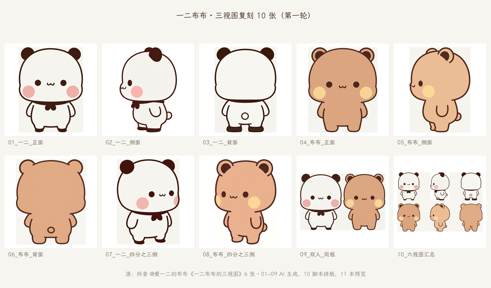

# three-view · 把一条「三视图」笔记变成一套 AI 创作底稿

> 一条 `SKILL.md` + 两个脚本（`contact_sheet.py` 拼版 / `fetch_font.sh` 取中文字体）。
> 不装 MCP、不调第三方服务，只依赖 Pillow 和生图工具。延续本仓库 `healing-comic/` 的写法：**能算的交给脚本，能核对的写进清单。**

## 这次回答了什么

针对用户给的抖音笔记
[《一二布布的三视图，可用于AI创作，需要的朋友自取》](https://www.douyin.com/note/7645624036777334882)（@爱一二的布布，6 张，12.9K 赞）：

1. **GitHub 上有没有能直接用的工具** → 分两类记：取图类（`Douyin_TikTok_Download_API` 21.2k、`douyin-downloader` 12.5k、`f2`、`yt-dlp`、`gallery-dl`）与三视图类（`ai-chan-sheets` 483 的拆件方法论）。
   结论与实测失败原因见 [`references/github-tools.md`](references/github-tools.md)。
2. **图怎么落地** → 沙箱出口只放行 GitHub/PyPI/npm，抖音 CDN 的 TLS 直接被重置（`curl` 返回 `000`）。
   于是把下载任务搬到 GitHub Actions runner 上跑（`tools/media-library/` 中继），
   `yt-dlp`/`gallery-dl` 都不认 `/note/` 图文链接，最后走「签名直链 + 魔数校验」通道，6 张图 2048px 原样落盘。
3. **怎么复刻成 10 张** → 先把原图拆成可核对的角色卡（[`references/character-spec.md`](references/character-spec.md)），
   再按同一套画布规则逐张复刻六视图，补 45° 与双人同框，最后脚本拼六视图汇总 + 总预览。
4. **交付物** → [`examples/round-01/`](examples/round-01/)：01–10 共 10 张 + `11_总预览.jpg`；
   文案见 [`references/copy-三视图-第一轮.md`](references/copy-三视图-第一轮.md)。

## 先看成品



| 序号 | 内容 | 来源 |
|---|---|---|
| 01–06 | 一二 正/侧/背 + 布布 正/侧/背 | AI 复刻，挂原图当参考 |
| 07–08 | 一二 / 布布 四分之三侧 | AI 补视角 |
| 09 | 双人同框（等高同基线） | AI 补 |
| 10 | 六视图汇总（2×3，无字） | **脚本拼版**，喂下游模型用 |
| 11 | 总预览（编号 + 标题 + 出处） | 脚本拼版 |

## 复现

```sh
cd three-view
python3 -m pip install Pillow                     # 唯一依赖
bash scripts/fetch_font.sh                        # 中文字体（走 codeload，不用 raw 域名）

# 换图只改 --indir，脚本会自动裁白边再等比缩放
SHEET_FONT=~/.fonts/LXGWWenKaiLite-Regular.ttf \
python3 scripts/contact_sheet.py preview --indir examples/round-01 \
  --out examples/round-01/11_总预览.jpg --cols 5 --cell 560 \
  --title "一二布布 · 三视图复刻 10 张（第一轮）" \
  --note "源：抖音 @爱一二的布布《一二布布的三视图》6 张"

python3 scripts/contact_sheet.py turnaround --indir examples/round-01 \
  --out examples/round-01/10_六视图汇总.png --cell 900
```

## 三条硬规则

1. **三视图先于一切**：没有角色卡就别开始画，画完再对已经晚了。
2. **每张新图都挂参考图**：正面挂正面、侧面挂侧面，双人挂两张正面。
3. **拼版交给脚本**：模型不擅长对齐、不擅长写字，`contact_sheet.py` 擅长。

## 许可

本目录文字与代码沿用仓库 MIT。样张为 AI 生成的重绘版本，原角色版权归抖音 @爱一二的布布；
仅作学习与二次创作参考，商用需另行授权。字体霞鹜文楷 SIL OFL 1.1。
