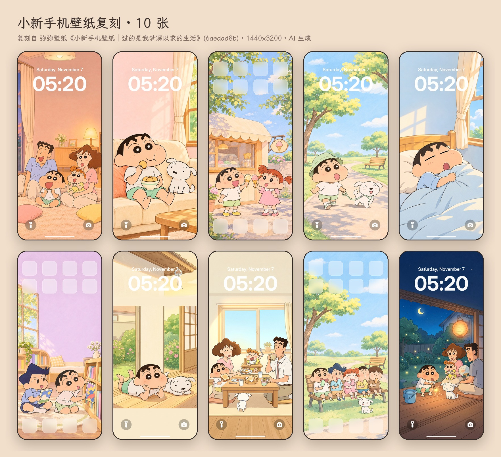

# xhs-wallpaper-replica

把一条小红书壁纸笔记变成一套可发布的复刻壁纸：下载原图 → 生图模型重画无字底图 → 脚本加 iOS 锁屏/主屏覆盖层 → 总图 + 双机封面 → 文案 → Google Drive 按轮归档。技能本体在 [SKILL.md](SKILL.md)。

## 这次跑的例子：弥弥壁纸《小新手机壁纸｜过的是我梦寐以求的生活》

| | 内容 | 位置 |
|---|---|---|
| 第 1 轮 | 原帖 7 张 PNG 原图（1440×3200，第 7 张为 1600×1600 双机海报）+ 笔记文本 | `examples/shinchan-6aedad8b/01-原图/` |
| 第 2 轮 | 复刻 10 张：6 张按原帖逐张重画 + 4 张按正文新补场景（缘侧发呆 / 全家早餐 / 长椅冰棍 / 夏夜线香花火）；全部是 1440×3200 干净壁纸，不带任何手机 UI | `examples/shinchan-6aedad8b/02-复刻/` |
| 总图 | 2×5 拼版 | `02-复刻/总图.jpg` |
| 封面 | 双机预览（两张竖图并排，仿原帖第 7 图的构图，不带手机 UI） | `02-复刻/封面-双机预览.jpg` |
| 第 4 轮 | **新画 10 张**（不是复刻）：雨天窗边 / 放学路上 / 厨房做蛋糕 / 阳台晾被子 / 海边沙堡 / 夏夜西瓜电视 / 雪天堆雪人 / 幼稚园午睡 / 河堤骑车 / 秋日银杏；同一画风、全新场景、1440×3200 干净壁纸 | `examples/shinchan-6aedad8b/03-新画10张/` |
| 第 5 轮 | **再新画 10 张**：樱花野餐 / 鲤鱼旗 / 向日葵花田 / 夏日祭捞金鱼 / 露营星空 / 雨后踩水洼 / 被炉吃橘子 / 装饰圣诞树 / 被窝手电看绘本 / 趴着画蜡笔画 | `examples/shinchan-6aedad8b/04-新画10张-第5轮/` |
| 第 6 轮 | **换一个 IP、换一种玩法**：一二布布《疑似梵高的真迹🤫》（自家 IP，1 张《星月夜》厚涂）→ 先下原片，再让两只熊走进 10 幅名画：梵高·向日葵 / 夜间露天咖啡座 / 麦田与柏树 / 杏花 · 莫奈·睡莲与日本桥 · 葛饰北斋·神奈川冲浪里 · 克里姆特·吻 · 蒙克·呐喊 · 维米尔·戴珍珠耳环的少女 · 达芬奇·蒙娜丽莎；画幅跟原帖一致 1532×2560 | `examples/vangogh-bubu-6aeeecba/`（`01-原片/` 原图+笔记，`02-复刻/` 底图+成图+总图） |
| 第 7 轮 | **一二布布鲜花壁纸**：一二布布壁纸分享（Neverland）《永远开满了鲜花》5 张原图 → 01–05 逐张复刻（百合花田 / 紫藤架 / 红花树 / 雪夜红梅 / 牡丹园）+ 06–10 同风格新花季（油菜花田 / 绣球雨巷 / 荷塘栈道 / 薰衣草黄昏 / 桂花院落）；画幅跟原帖一致 1536×2752，原片与结果分开归档 | `examples/flowers-bubu-6ae3391a/`（`01-原片/` 5 张原图+笔记，`02-复刻/` 底图+成图+总图） |
| 第 8 轮 | **小猫和樱花 · 治愈系壁纸**：屏上集《治愈系壁纸｜小猫和樱花🌸》4 张原图（850×1850 ≈ 9:20）→ 01–04 逐张复刻（樱花晴日 / 海边日落 / 雨后彩虹 / 黄昏许愿）+ 05–10 同一组猫、同一面海墙的新季节（樱吹雪 / 夏日向日葵 / 秋日红叶 / 雪日山茶 / 星夜萤火 / 晨雾热气球）；标准 1440×3200 干净壁纸 + `手机UI预览/`，原片与结果分开归档 | `examples/cat-sakura-6ae8870f/`（`01-原片/` 4 张原图+笔记，`02-复刻/` 底图+壁纸+总图+iOS 预览总图） |
| 第 9 轮 | **猫和老鼠 · 今晚先停战**：小李壁纸分享站《猫和老鼠手机壁纸｜今晚先停战🛋️》18 张原图（1290×2796 ≈ 9:20）→ 原帖多于 10 张，挑最有变化的 10 张逐张复刻（沙发盖被 / 窗边月牙 / 餐桌热牛奶 / 递奶酪 / 火柴盒小床 / 红围巾 / 睡前绘本 / 拖鞋里打盹 / 雨夜窗边 / 床头灯晚安，对应原图 01/03/04/05/07/09/10/11/15/18）；经典 40–50 年代赛璐璐画风、上半屏留给时钟的素墙；标准 1440×3200 干净壁纸 + `手机UI预览/`，原片与结果分开归档 | `examples/tomjerry-6aed5b12/`（`01-原片/` 18 张原图+笔记，`02-复刻/` 底图+壁纸+总图+iOS 预览总图） |
| 第 3 轮 | 小红书视频下载测试（木可 · 吉隆坡机场 T2 过夜转机，64 s）：网页码流 + 封面进 git，262 MB 无水印原片由 runner 直传 Drive | `examples/video-test-6a4be129/` |
| 文案 | 第 2 轮发布文案 + 第 1 轮原帖存档 | `references/copy-小新壁纸.md` |
| 文案（第 6 轮） | 名画 10 张的标题 / 正文 / 话题 / 发图顺序 | `references/copy-一二布布名画.md` |
| 文案（第 7 轮） | 鲜花 10 张的标题 / 正文 / 话题 / 发图顺序 | `references/copy-一二布布鲜花.md` |
| 文案（第 8 轮） | 小猫 10 张的标题 / 正文 / 话题 / 发图顺序 + 锁屏备注 | `references/copy-小猫樱花.md` |
| 文案（第 9 轮） | 猫鼠 10 张的标题 / 正文 / 话题 / 发图顺序 + 锁屏备注 | `references/copy-猫和老鼠停战.md` |
| 工具盘点 | GitHub 上的小红书原图下载工具 + token 取法 | `references/github-tools.md` |

Google Drive：`我的云端硬盘/一二和布布 - 原始素材/素材 05/` 下 `第1轮-原版7张（小红书下载）`、`第2轮-复刻10张`（10 张干净 PNG、总图、封面、文案 Doc、SKILL）、`第3轮-视频下载测试`（`原片/` 与 `结果/` 分开）、`第4轮-新画10张`、`第5轮-新画10张`（各 10 张全新场景的干净 PNG、总图、封面、文案 Doc、spec）。`第6轮-一二布布名画风`（**`原片/` 与 `结果/` 分开**：原片 = 小红书无水印 webp + 转 PNG + note.json + 笔记信息 Doc；结果 = 名画01…10.png 1532×2560 + 总图 + spec + 文案 Doc）。`第7轮-一二布布鲜花壁纸`（同样 `原片/`（5 张原图按小红书网页版命名 + 原片总图 + note.json + 笔记信息 Doc）与 `结果/`（鲜花01…10.png 1536×2752 + 总图 + spec + 文案 Doc）分开）。`第8轮-小猫樱花治愈壁纸`（`原片/`（4 张原图 + 原片总图 + note.json + 笔记信息 Doc）与 `结果/`（小猫01…10.png 1440×3200 + 总图 + 封面-双机预览 + spec + 文案 Doc + `手机UI预览/` 10 张 iOS 叠层 + 预览总图）分开）。`第9轮-猫和老鼠停战壁纸`（`原片/`（18 张原图按小红书网页版命名 + 原片总图（★ 标出选中的 10 张）+ note.json + 笔记信息 Doc）与 `结果/`（猫鼠01…10.png 1440×3200 + 总图 + 封面-双机预览 + spec + 文案 Doc + `手机UI预览/` 10 张 iOS 叠层 + 预览总图）分开）。



## 复现

```bash
# 0) 原图：沙箱里走 tools/xhs-relay（见 tools/xhs-relay/README.md）；本机直接拼 token 下载
# 1) 底图：按 SKILL.md ③ 用 generate_image 出 10 张 688×1536 无字图 → 02-复刻/art/01..10.png
# 2) 字体
mkdir -p ~/.fonts && cd ~/.fonts   # Inter-Variable.ttf（google/fonts 仓库）+ LXGWWenKai-Medium.ttf（lxgw/LxgwWenKai release）
# 3) 合成
python3 scripts/phone_mockup.py all examples/shinchan-6aedad8b/02-复刻/spec.json \
    --art-dir examples/shinchan-6aedad8b/02-复刻/art --out /path/to/第2轮-复刻10张 --format png
```

```bash
# 第 6 轮这种「名画风 / 跟原帖同画幅」的用 painting_set.py（不放大到 1440×3200，按 spec.canvas 盖满裁切）
python3 scripts/painting_set.py examples/vangogh-bubu-6aeeecba/02-复刻/spec.json \
    --art-dir examples/vangogh-bubu-6aeeecba/02-复刻/art --out /path/to/第6轮/结果 --format png
```

仓库里只留 `art/`（真正的源文件，688×1536 PNG）和 `壁纸/` 的 JPG 留档；1440×3200 的 PNG 交付件可随时由上面一条命令重新生成。每轮固定交付两份：干净 PNG（壁纸本体）+ `手机UI预览/`（`--ui ios` 叠 iOS 锁屏/主屏层的同名 JPG + 预览总图，用来看装机实测效果，不是壁纸）。
UI 一律由脚本「加」在干净图上，从不让模型画了再「去」——加是几秒钟的确定性叠加，去要重生成。第 2/4/5/6/7 轮的预览都已按这个方式补齐。

## 说明

- 角色为第三方 IP（蜡笔小新），仅供个人壁纸、非商用；全部图片为 AI 生成，发布时勾选「AI 生成」。
- 第 6 轮的一二布布是自家 IP，没有第三方版权问题；名画本身早已进入公有领域，复刻的只是「风格」，照样标 AI 生成。
- 688×1536 → 1440×3200 是 Lanczos 放大，手机上观感正常，100% 看比原帖略软；要更锐利在本机过一遍 Real-ESRGAN（anime 模型，×2）再合成。
